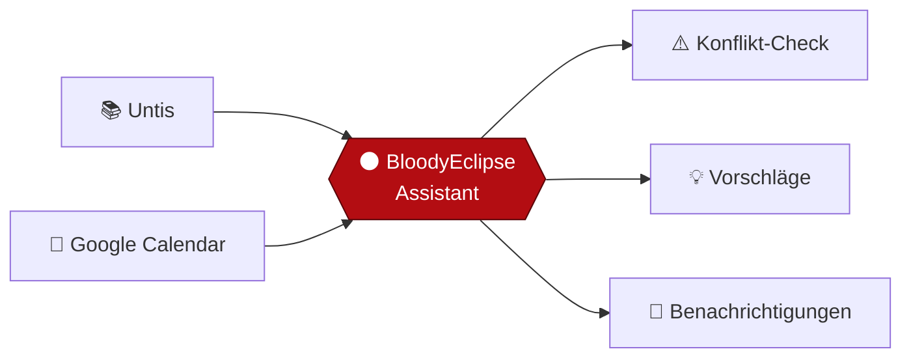

<p align="center">
  
</p>

<p align="center">
  <b>Your perfect <i>half</i> intelligent assistant 🌑🩸</b><br>
  <sub>Stundenplan trifft Kalender – wenn der Mond rot wird, ist dein Tag geplant.</sub>
</p>

<p align="center">
  
  
  
  
</p>

---

## 🌒 Was ist das?

Der **BloodyEclipseAssistant** ist ein persönlicher Assistent, der zwei Welten verbindet:

- 📚 **Untis** – dein Stundenplan, Vertretungen und Ausfälle
- 📅 **Google Calendar** – Termine, Erinnerungen, Freizeit

Er gleicht beides ab, erkennt Konflikte und hilft dir, den Überblick zu behalten. Und ja: Er ist nur **halb** intelligent – dafür mit voller Überzeugung. 😉

## ✨ Features

| | Feature | Status |
|---|---|---|
| 📚 | Stundenplan aus Untis abrufen | 🔜 geplant |
| 📅 | Termine mit Google Calendar synchronisieren | 🔜 geplant |
| ⚠️ | Konflikte zwischen Unterricht und Terminen erkennen | 🔜 geplant |
| 🔔 | Erinnerungen bei Vertretung und Ausfall | 🔜 geplant |
| 🧠 | „Halb-intelligente" Vorschläge für freie Zeitfenster | 💡 Idee |
| 🌑 | Eclipse-Modus (Dark Theme, natürlich blutrot) | 💡 Idee |

> Den genauen Fortschritt findest du in der [**TODO.md**](TODO.md).

## 🗺️ So funktioniert's



## 🌗 Mondphasen der Entwicklung

```
🌑  Idee & Repository          ✅
🌒  Untis-Anbindung            ⬜
🌓  Google-Calendar-Anbindung  ⬜
🌔  Abgleich & Konflikt-Logik  ⬜
🌕  Release                    ⬜  ← Vollmond, aber blutrot
```

## 🚀 Loslegen

> ⚠️ Das Projekt befindet sich noch am Anfang – die Schritte unten sind der Plan.

```bash
# Repository klonen
git clone https://github.com/Duo-FrozenPIXEL/BloodyEclipseAssistant.git
cd BloodyEclipseAssistant
```

<details>
<summary>🔐 Zugangsdaten (Platzhalter)</summary>

Zugangsdaten gehören **nie** ins Repository. Lege sie in einer lokalen `.env`-Datei ab (steht in der `.gitignore`):

```env
UNTIS_SERVER=
UNTIS_SCHOOL=
UNTIS_USER=
UNTIS_PASSWORD=
GOOGLE_CLIENT_ID=
GOOGLE_CLIENT_SECRET=
```

</details>

## 🧩 Fun Facts

- 🌑 Eine **Blutmond**-Färbung entsteht bei einer totalen Mondfinsternis: Der Mond liegt im Erdschatten und wird nur noch von rotem Licht bestrahlt, das durch die Erdatmosphäre gebrochen wird.
- 🤖 „Halb intelligent" heißt: kluge Vorschläge – aber du hast immer das letzte Wort.

## 🤝 Mitmachen

Ideen, Bugs oder Wünsche? Erstelle gerne ein [Issue](https://github.com/Duo-FrozenPIXEL/BloodyEclipseAssistant/issues) oder einen Pull Request.

---

<p align="center">
  Made with 🩸 by <a href="https://github.com/Duo-FrozenPIXEL"><b>Duo-FrozenPIXEL</b></a>
</p>
