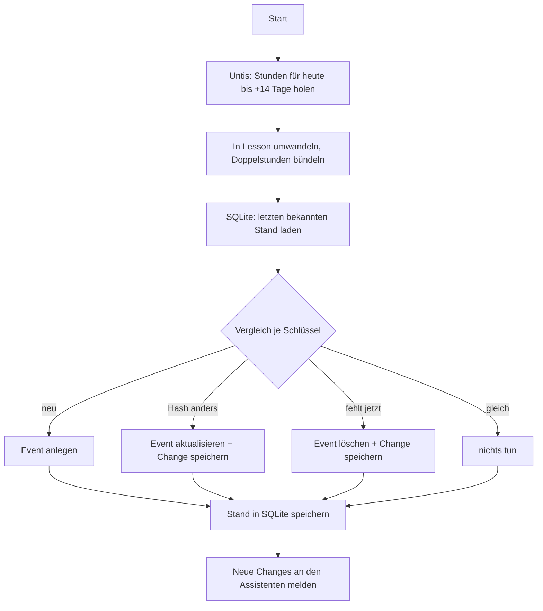

# 🌒 Plan 01 – Untis ↔ Google Calendar

Ziel: Der Untis-Stundenplan steht immer aktuell im Google-Kalender, ohne dass man etwas tun muss. Zurück zum [Gesamtplan](PLAN.md).

## 1. Grundsätze

1. **Einweg.** Untis → Google. In Untis wird nie geschrieben.
2. **Eigener Kalender.** Der Assistent legt einen Zweitkalender an („Untis 🌑") und schreibt ausschließlich dort hinein. Private Kalender werden nur gelesen.
3. **Idempotent.** Derselbe Sync zweimal hintereinander ändert beim zweiten Mal nichts.
4. **Änderungen sind Ereignisse.** Jeder Unterschied zwischen altem und neuem Stand wird als `Change` gespeichert – daraus entstehen später die Ansagen.

## 2. Untis-Seite

### 2.1 Zugriff

- Paket: `webuntis` (PyPI), spricht die JSON-RPC-Schnittstelle von WebUntis.
- Benötigt: Server (z. B. `nessa.webuntis.com`), Schulkürzel, Benutzername, Passwort. Server und Kürzel stehen in der Adresse der WebUntis-Seite der Schule.
- Sitzung pro Sync-Lauf öffnen und wieder schließen (`login()` / `logout()`); WebUntis wirft offene Sitzungen nach kurzer Zeit ohnehin weg.

```python
with webuntis.Session(server=..., school=..., username=..., password=...,
                      useragent="BloodyEclipseAssistant").login() as s:
    periods = s.my_timetable(start=today, end=today + timedelta(days=14))
```

### 2.2 Was pro Stunde ausgelesen wird

| Untis-Feld | Bedeutung | Ziel in `Lesson` |
|---|---|---|
| `start`, `end` | Beginn/Ende | `start`, `end` (Zeitzone setzen) |
| `subjects` | Fach (Kürzel + Langname) | `subject`, `subject_long` |
| `teachers`, `rooms` | aktuelle Lehrkraft / Raum | `teachers`, `rooms` |
| `original_teachers`, `original_rooms` | ursprünglich geplant | `original_*` |
| `code` | leer, `cancelled` oder `irregular` | `status` |
| Vertretungstext | Freitext der Schule | `note` |
| Stundenart | Unterricht, Prüfung … | `status = "exam"` bei Prüfung |

Die genauen Feldnamen und welche davon das Schülerkonto wirklich geliefert bekommt, werden in Meilenstein M1 mit dem echten Konto geprüft und hier nachgetragen.

### 2.3 Aufbereitung

- **Doppelstunden zusammenfassen:** Direkt aufeinanderfolgende Stunden mit gleichem Fach, Raum, Lehrkraft und Status werden zu einem Eintrag. Fällt nur eine Hälfte aus, bleiben es zwei Einträge.
- **Stabiler Schlüssel:** `key = Datum + Startzeit + Fachkürzel + Klasse/Gruppe`. Bewusst **nicht** die Untis-interne ID, weil die sich bei Vertretungen ändern kann und dann Löschen+Neuanlegen statt einer Änderung entstünde.
- **Inhalts-Hash:** `sha1(Status, Räume, Lehrkräfte, Ende, Notiz)`. Ändert sich der Hash bei gleichem Schlüssel, ist es eine Änderung.

### 2.4 Ersatzweg, falls JSON-RPC gesperrt ist

Manche Schulen sperren die Methode für Schülerkonten oder nutzen einen fremden Login. Dann:

1. Die interne Web-Schnittstelle nutzen, die auch die WebUntis-Seite selbst verwendet (gleicher Login, Wochenplan als JSON).
2. Wenn auch das nicht geht: den Kalender-Abo-Link (iCal) aus den WebUntis-Profileinstellungen einlesen, sofern die Schule ihn anbietet. Liefert weniger Details zu Vertretungen.

Weil alles hinter `untis/client.py` liegt, ändert der Ersatzweg nur diese eine Datei.

## 3. Google-Seite

### 3.1 Einmalige Einrichtung (macht der Mensch, ca. 10 Minuten)

1. In der Google Cloud Console ein Projekt anlegen und die **Google Calendar API** aktivieren.
2. OAuth-Zustimmungsbildschirm einrichten, Nutzertyp „Extern".
3. Veröffentlichungsstatus auf **„In Produktion"** stellen. Im Status „Test" verfällt das Login nach 7 Tagen und der Assistent hört nach einer Woche einfach auf zu funktionieren. Eine Prüfung durch Google ist für die private Nutzung nicht nötig; beim Login erscheint dann einmal ein Warnhinweis, den man bestätigt.
4. OAuth-Client vom Typ **„Desktop-App"** erstellen, JSON herunterladen und als `secrets/credentials.json` ablegen.
5. `python -m bea login` ausführen und im Browser zustimmen. Das Token landet in `secrets/token.json`.

### 3.2 Berechtigungen (so wenig wie möglich)

| Scope | Wofür |
|---|---|
| `calendar.app.created` | Eigenen Zweitkalender anlegen und nur dort Termine schreiben |
| `calendar.calendarlist.readonly` | Liste der vorhandenen Kalender sehen |
| `calendar.events.readonly` | Private Termine lesen (für Konflikt-Erkennung und Tagesansage) |

Damit kann der Assistent technisch gar keine privaten Termine verändern oder löschen.

### 3.3 Der Untis-Kalender

- Beim ersten Sync anlegen (`calendars.insert`, Name aus `GOOGLE_CALENDAR_NAME`, Zeitzone `Europe/Berlin`), die Kalender-ID in SQLite merken.
- Wurde der Kalender von Hand gelöscht, beim nächsten Lauf neu anlegen und komplett neu befüllen.

### 3.4 So sieht ein Termin aus

| Feld | Inhalt |
|---|---|
| `id` | `bea` + SHA1 des Schlüssels (nur Zeichen `0-9a-f`, von Google erlaubt) |
| `summary` | `Mathe` · bei Ausfall `❌ Mathe (entfällt)` · bei Vertretung `🔁 Mathe` · bei Prüfung `📝 Mathe` |
| `location` | Raum |
| `description` | Lehrkraft, Vertretungstext, ggf. „ursprünglich: Raum 204 bei Hr. X" |
| `start` / `end` | mit `timeZone: Europe/Berlin` |
| `colorId` | normal: Standard · Ausfall: grau · Änderung: orange · Prüfung: rot |
| `transparency` | bei Ausfall `transparent` (blockiert die Zeit nicht) |
| `reminders` | aus – erinnert wird per Stimme |
| `extendedProperties.private` | `bea_key`, `bea_hash`, `bea_source=untis` |

Lesbare Fachnamen statt Kürzel kommen aus einer Zuordnung in der Konfiguration (`M → Mathe`), mit dem Untis-Langnamen als Rückfall.

## 4. Sync-Ablauf



### 4.1 Regeln im Detail

- **Zeitfenster:** heute bis `BEA_SYNC_DAYS_AHEAD` Tage voraus. Vergangenes wird nicht mehr angefasst.
- **Vergleichsbasis ist SQLite**, nicht Google. Das spart API-Aufrufe. Einmal pro Nacht läuft zusätzlich ein Voll-Abgleich gegen Google (Events mit `bea_source=untis` abfragen), der von Hand gelöschte oder veränderte Einträge repariert.
- **Ausfall:** je nach `BEA_CANCELLED_MODE` als „entfällt" markieren (Standard) oder löschen.
- **Schon mal gelöschte ID:** Google lehnt das erneute Anlegen einer gelöschten Event-ID mit Fehler 409 ab. Dann stattdessen aktualisieren und den Status wieder auf `confirmed` setzen.
- **Schutz vor Massenlöschung:** Liefert Untis plötzlich gar keine Stunden für einen Tag, an dem vorher welche standen, wird erst beim zweiten übereinstimmenden Abruf gelöscht. Verhindert, dass ein Untis-Schluckauf den Kalender leert. Ferien und Feiertage sind davon ausgenommen, weil dort schon vorher nichts stand.
- **Erster Lauf:** legt alles an, erzeugt aber **keine** Changes – sonst würde der Assistent 60 „neue Stunden" vorlesen.

### 4.2 Takt

| Zeit | Intervall |
|---|---|
| Schultage 06:00–17:00 | alle `BEA_SYNC_INTERVAL_MINUTES` (Standard 10) |
| sonst | stündlich |
| 03:30 | Voll-Abgleich gegen Google |

### 4.3 Fehlerbehandlung

| Fehler | Verhalten |
|---|---|
| Kein Netz / Untis nicht erreichbar | Lauf überspringen, beim nächsten Takt erneut; nach 3 Fehlschlägen einmalige Ansage |
| Untis-Login abgelehnt | Nicht endlos wiederholen (Kontosperre vermeiden); Ansage „Untis-Anmeldung fehlgeschlagen" |
| Google 401 / Token ungültig | Ansage „Bitte neu bei Google anmelden", Sync pausiert bis `bea login` |
| Google 403/429 (Limit) | Warten mit wachsendem Abstand, dann erneut |
| Google 5xx | Bis zu 3 Wiederholungen |

Jeder Lauf schreibt eine Zeile ins Log: Dauer, Anzahl angelegt/geändert/gelöscht, Fehler.

## 5. SQLite-Tabellen

```sql
CREATE TABLE lessons (
    key        TEXT PRIMARY KEY,
    hash       TEXT NOT NULL,
    event_id   TEXT NOT NULL,
    start_ts   TEXT NOT NULL,
    end_ts     TEXT NOT NULL,
    payload    TEXT NOT NULL,      -- Lesson als JSON
    missing_count INTEGER NOT NULL DEFAULT 0
);

CREATE TABLE changes (
    id          INTEGER PRIMARY KEY AUTOINCREMENT,
    kind        TEXT NOT NULL,
    before      TEXT,
    after       TEXT,
    detected_at TEXT NOT NULL,
    announced_at TEXT              -- NULL = noch nicht angesagt
);

CREATE TABLE meta (key TEXT PRIMARY KEY, value TEXT);  -- calendar_id, last_sync, …
```

## 6. Konflikt-Erkennung

Nach jedem Sync, getrennt vom Schreiben:

1. Private Termine der nächsten 7 Tage aus allen Kalendern lesen (außer dem Untis-Kalender).
2. Ganztägige und als „frei" markierte Termine ignorieren.
3. Überschneidung mit einer nicht ausgefallenen Stunde = `Conflict`.
4. Umgekehrt nützlich: Fällt eine Stunde aus, die einen Konflikt verursacht hat, ist das eine gute Nachricht und wird so angesagt.

Daraus entsteht außerdem die Liste freier Zeitfenster (Lücken zwischen Unterricht und Terminen ab 45 Minuten) für spätere Vorschläge.

## 7. Tests

- **Vergleichslogik** mit festen Beispieldaten: neu, geändert, ausgefallen, wiederhergestellt, verschwunden, Doppelstunde halb ausgefallen.
- **Untis-Übersetzung** mit gespeicherten, anonymisierten Antworten aus M1.
- **Google-Schicht** gegen eine Attrappe; ein echter Durchlauf nur von Hand mit `--dry-run` und einem Test-Kalender.
- **Idempotenz:** zweimal syncen, beim zweiten Mal null Schreibzugriffe.

## 8. Umsetzungsschritte

1. `config.py` + `bea doctor`
2. `untis/client.py`: Login, Abruf, Ausgabe als Tabelle im Terminal → **M1**
3. `models.py`, Doppelstunden, Schlüssel und Hash, Tests dazu
4. `google/auth.py`: Login-Befehl, Token-Erneuerung
5. `google/calendar.py`: Kalender anlegen, Event anlegen/ändern/löschen
6. `sync/state.py` + `sync/engine.py`, `--dry-run` → **M2**
7. Changes erzeugen und speichern, Schutzregeln, Voll-Abgleich → **M3**
8. `assistant/conflicts.py` → **M6**
