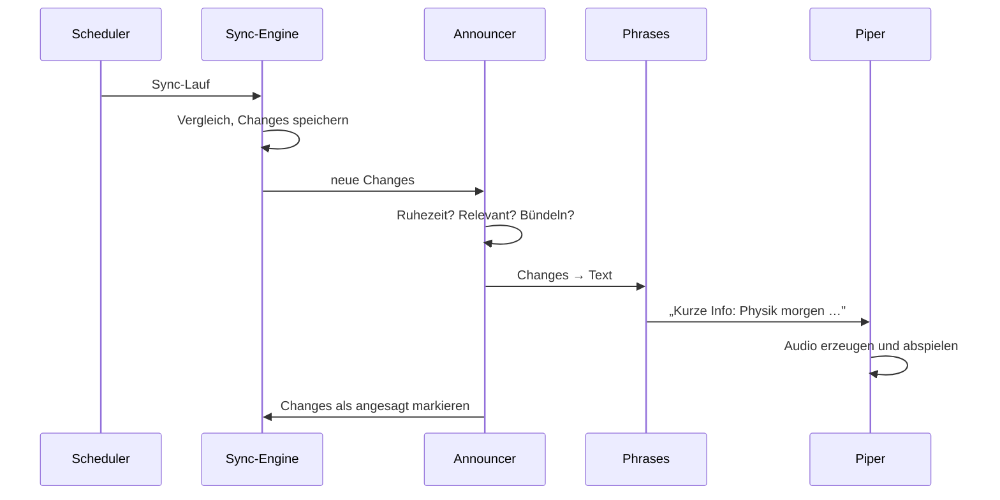

# 🌓 Plan 02 – Sprachausgabe & Assistenz-Verhalten

Ziel: Der Assistent meldet sich **von selbst**, im richtigen Moment, in ganzen Sätzen – wie jemand, der den Stundenplan im Blick hat und kurz Bescheid sagt. Zurück zum [Gesamtplan](PLAN.md).

## 1. Was ihn zur Assistenzkraft macht

Eine Stimme allein reicht nicht. Entscheidend sind vier Dinge:

1. **Er spricht ungefragt**, wenn sich etwas ändert.
2. **Er fasst zusammen**, statt Listen vorzulesen.
3. **Er weiß, wann er still sein muss.**
4. **Er sagt nichts doppelt.**

## 2. Wann er spricht

| Auslöser | Zeitpunkt | Beispiel |
|---|---|---|
| Morgen-Ansage | `BEA_BRIEFING_TIME` an Schultagen | „Guten Morgen. Heute hast du sechs Stunden, von zehn vor acht bis Viertel nach eins. Los geht's mit Mathe in Raum 204. Die dritte Stunde, Englisch, fällt aus. Um vier hast du Zahnarzt." |
| Änderung erkannt | sofort nach dem Sync, außerhalb der Ruhezeit | „Kurze Info: Physik morgen in der fünften Stunde fällt aus." |
| Gleich geht's weiter | 5 Minuten vor einer Stunde mit Raum- oder Lehrerwechsel | „In fünf Minuten Chemie – heute in Raum 112 statt 208." |
| Abend-Vorschau | 19:30, nur wenn morgen etwas Besonderes ist | „Morgen beginnt dein Tag erst zur dritten Stunde. Denk an die Deutsch-Klausur in der vierten." |
| Konflikt | wenn er neu entsteht | „Achtung: Dein Termin ‚Fahrschule' am Donnerstag überschneidet sich mit der sechsten Stunde Sport." |
| Auf Zuruf | `bea say heute` / `morgen` / `aenderungen` | Tagesplan bzw. Änderungen seit der letzten Ansage |
| Störung | nach wiederholtem Fehler, einmal | „Ich komme gerade nicht an Untis heran. Dein Kalender ist auf dem Stand von halb zehn." |

An Tagen ohne Unterricht entfällt die Morgen-Ansage; private Termine werden dann nur auf Zuruf genannt.

## 3. Regeln gegen Nerven

- **Ruhezeit** (`BEA_QUIET_HOURS`): In dieser Zeit wird nichts gesprochen. Änderungen werden gesammelt und in der Morgen-Ansage genannt.
- **Einmal reicht:** Jede `Change` bekommt nach der Ansage einen Zeitstempel (`announced_at`) und wird nie wieder vorgelesen.
- **Bündeln:** Mehrere Änderungen aus einem Sync-Lauf werden zu einer Ansage. Ab vier Änderungen nur noch Zusammenfassung („Morgen fallen drei Stunden aus: …").
- **Nur Relevantes:** Sofort angesagt werden Änderungen für heute und morgen. Spätere Tage kommen in die Abend-Vorschau des Vortags.
- **Hin und zurück hebt sich auf:** Fällt eine Stunde aus und wird vor der Ansage wieder eingetragen, wird nichts gesagt.
- **Stumm-Schalter:** `bea mute 2h` für Besuch, Videocalls und Ähnliches.

## 4. Von Daten zu Sätzen (`speech/phrases.py`)

Reine Vorlagen-Logik, kein KI-Modell nötig. Das macht die Ausgabe vorhersagbar, offline und testbar.

### 4.1 Bausteine

| Baustein | Regel | Beispiel |
|---|---|---|
| Uhrzeit | umgangssprachlich | 07:50 → „zehn vor acht", 13:15 → „Viertel nach eins" |
| Stunde | Ordnungszahl aus dem Zeitraster | „in der dritten Stunde" |
| Tag | relativ, sonst Wochentag | „heute", „morgen", „am Donnerstag" |
| Fach | Sprechname aus der Konfiguration | `M` → „Mathe", `PoWi` → „Politik" |
| Raum | Ziffern einzeln oder als Zahl, einstellbar | „Raum zwei null vier" |
| Lehrkraft | Sprechname aus der Konfiguration, sonst weglassen | `MÜL` → „Frau Müller" |
| Anzahl | ausgeschrieben, richtige Mehrzahl | „eine Stunde", „sechs Stunden" |

Kürzel, die nicht in der Zuordnung stehen, werden nicht buchstabiert, sondern ausgelassen oder durch den Untis-Langnamen ersetzt. Ein vorgelesenes „Em Ü El" zerstört den Eindruck sofort.

### 4.2 Abwechslung

Jede Ansage-Art hat mehrere gleichwertige Formulierungen, aus denen zufällig gewählt wird („Kurze Info:", „Nur damit du's weißt:", „Es gibt eine Änderung:"). Die Begrüßung richtet sich nach der Tageszeit. Das ist der einfachste Weg, damit es nicht nach Ansageband klingt.

### 4.3 Aufbau der Morgen-Ansage

1. Begrüßung
2. Rahmen: Anzahl Stunden, Beginn und Ende
3. Erste Stunde mit Raum
4. Besonderheiten: Ausfälle, Vertretungen, Prüfungen
5. Private Termine heute
6. Konflikte, falls vorhanden

Ein normaler Tag ohne Besonderheiten bleibt bei zwei Sätzen.

### 4.4 Später möglich: freiere Formulierungen

Die Vorlagen können optional durch ein Sprachmodell ersetzt werden, das aus denselben strukturierten Daten formuliert. Das bleibt ein Zusatz hinter einem Schalter; die Vorlagen sind immer der Rückfall, damit der Assistent auch ohne Internet spricht.

## 5. Stimme (`speech/tts.py`)

- **Engine:** Piper, installiert über `pip install piper-tts`. Rechnet lokal, braucht kein Internet und keine Konten.
- **Stimme:** `de_DE-thorsten-high`. Auf schwacher Hardware (älterer Raspberry Pi) `de_DE-thorsten-medium`. Einstellbar über `BEA_VOICE`.
- **Stimmdateien** (`.onnx` + `.onnx.json`) werden beim ersten Start in `voices/` geladen und nicht ins Repo eingecheckt.
- **Laden:** Die Stimme wird beim Start von `bea run` einmal geladen und bleibt im Speicher, damit Ansagen ohne Verzögerung beginnen.
- **Zwischenspeicher:** Häufige feste Sätze (Begrüßungen, Fehlermeldungen) werden als WAV zwischengespeichert.
- **Lizenz:** Piper steht unter GPL-3.0. Entweder bekommt das Projekt dieselbe Lizenz, oder Piper wird nur als eigenständiges Programm aufgerufen statt importiert. Empfehlung: GPL-3.0 für das Projekt, dann ist beides erlaubt.

```python
class Speaker(Protocol):
    def say(self, text: str, *, priority: int = 0) -> None: ...

class PiperSpeaker:      # Standard
class ConsoleSpeaker:    # schreibt nur ins Terminal – für Tests und Geräte ohne Lautsprecher
```

Durch das gemeinsame Interface lässt sich später eine andere Stimme oder ein Cloud-Dienst einsetzen, ohne den Rest anzufassen.

## 6. Wiedergabe (`speech/player.py`)

- Ausgabe über `sounddevice`; Rückfall auf `aplay` (Linux) bzw. das Windows-Bordmittel, wenn kein Audiogerät gefunden wird.
- **Warteschlange:** Ansagen laufen nacheinander, nie übereinander. Störungsmeldungen und „Gleich geht's weiter" haben Vorrang.
- **Aufmerksamkeitston:** Ein kurzer, leiser Ton vor ungefragten Ansagen, damit der erste Satzanfang nicht verloren geht.
- **Lautstärke** und Ausgabegerät über die Konfiguration.
- `bea doctor` spielt einen Testsatz ab und meldet, wenn kein Lautsprecher erreichbar ist.

## 7. Zusammenspiel mit dem Sync



Als „angesagt" markiert wird erst **nach** erfolgreicher Wiedergabe. Stürzt der Dienst mittendrin ab, wird die Änderung beim nächsten Start nachgeholt.

## 8. Ausbaustufe: Zuhören

Bewusst erst nach der stabilen Sprachausgabe, weil es deutlich mehr Aufwand ist:

| Baustein | Technik |
|---|---|
| Aktivierungswort | `openWakeWord` mit eigenem Wort (z. B. „Eclipse") |
| Sprache → Text | `faster-whisper` (klein, deutsch), lokal |
| Verstehen | feste Muster für wenige Fragen: „Was habe ich morgen?", „Wann habe ich aus?", „Fällt was aus?", „Wann habe ich wieder Mathe?" |
| Antwort | dieselben Satz-Bausteine wie oben |

Voraussetzung ist ein Mikrofon am Gerät. Die Antworten nutzen vollständig die Logik aus diesem Plan, es kommt nur ein neuer Eingang dazu.

## 9. Tests

- **Sätze:** Für feste Beispieltage wird der erzeugte Text mit dem erwarteten verglichen (ohne die Zufalls-Varianten).
- **Uhrzeiten und Zahlen:** Tabelle mit Grenzfällen (volle Stunde, halb, Viertel, Mitternacht).
- **Ansage-Regeln:** Ruhezeit, Bündelung, „hin und zurück", doppelte Ansage – jeweils mit simulierter Uhr.
- **Hörprobe:** `bea say --demo` spielt alle Ansage-Arten mit Beispieldaten ab, um Aussprache und Tempo zu prüfen. Falsch ausgesprochene Fächer oder Namen werden über die Sprechnamen-Zuordnung korrigiert.

## 10. Umsetzungsschritte

1. `speech/tts.py` mit Piper und `ConsoleSpeaker`, Testsatz in `bea doctor`
2. `speech/phrases.py`: Uhrzeit, Stunde, Tag, Fach – mit Tests
3. `assistant/briefing.py` + `bea say heute|morgen` → **M4**
4. `speech/player.py`: Warteschlange, Aufmerksamkeitston
5. `assistant/announcer.py`: Regeln aus Abschnitt 3
6. `scheduler.py`: Morgen-Ansage, Abend-Vorschau, „Gleich geht's weiter" → **M5**
7. Konflikt-Ansagen anbinden → **M6**
8. `deploy/bea.service`, Autostart, Verhalten nach Netzausfall → **M7**
