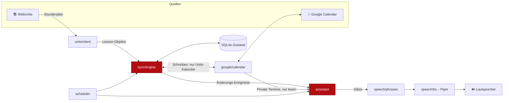

# 🌑 Technischer Gesamtplan

Dieses Dokument legt fest, **wie** der BloodyEclipseAssistant gebaut wird. Die beiden Detailpläne:

- [01 – Untis ↔ Google Calendar](01-untis-google-sync.md)
- [02 – Sprachausgabe & Assistenz-Verhalten](02-sprachausgabe.md)

## 1. Ziel in einem Satz

Ein Dienst, der dauerhaft im Hintergrund läuft, den Untis-Stundenplan automatisch in einen eigenen Google-Kalender spiegelt, Änderungen (Ausfall, Vertretung, Raumwechsel) erkennt und sie **von sich aus laut ansagt** – wie eine Assistenzkraft, die mitdenkt, statt eines Programms, das man abfragen muss.

## 2. Festgelegte Technik

| Thema | Entscheidung | Warum |
|---|---|---|
| Sprache | Python 3.12 | Fertige Bibliotheken für Untis, Google und Sprachsynthese |
| Untis-Zugriff | Paket `webuntis` (JSON-RPC), gekapselt hinter eigenem Interface | Austauschbar, falls die Schule den Zugriff einschränkt |
| Google-Zugriff | `google-api-python-client` + `google-auth-oauthlib` | Offizielle Bibliotheken |
| Sync-Richtung | **Einweg: Untis → Google** | Untis ist die Wahrheit; nichts wird je nach Untis zurückgeschrieben |
| Ziel-Kalender | Eigener Zweitkalender, vom Assistenten angelegt | Private Termine werden nie angefasst |
| Zustand | SQLite-Datei `data/bea.sqlite3` | Kein Server nötig, übersteht Neustarts |
| Sprachausgabe | Piper (`piper-tts`), Stimme `de_DE-thorsten-high` | Läuft offline, klingt natürlich, auch auf einem Raspberry Pi schnell genug |
| Zeitsteuerung | `APScheduler` im eigenen Prozess | Sync-Intervall und feste Ansagezeiten in einem Dienst |
| Betrieb | `systemd`-Dienst (Linux/Raspberry Pi), alternativ Autostart unter Windows | Startet von selbst, läuft ohne Bildschirm |
| Konfiguration | `.env` (siehe `.env.example`) | Keine Zugangsdaten im Repo |
| Werkzeuge | `pytest`, `ruff` | Tests und einheitlicher Stil |

## 3. Architektur



Der entscheidende Punkt: Die Sync-Engine liefert nicht nur Kalendereinträge, sondern auch **Änderungs-Ereignisse**. Genau diese Ereignisse sind der Stoff, aus dem der Assistent spricht.

## 4. Projektstruktur

```
bea/
├── __main__.py          # Einstieg: python -m bea
├── cli.py               # Befehle: login, sync, say, run, doctor
├── config.py            # .env laden und prüfen
├── models.py            # Lesson, Change, Conflict
├── untis/
│   └── client.py        # WebUntis-Login, Stundenplan → Lesson
├── google/
│   ├── auth.py          # OAuth-Flow, Token speichern/erneuern
│   └── calendar.py      # Kalender anlegen, Events lesen/schreiben
├── sync/
│   ├── engine.py        # Soll/Ist-Vergleich, Änderungen erzeugen
│   └── state.py         # SQLite-Zugriff
├── assistant/
│   ├── briefing.py      # Morgen-/Abend-Ansage zusammenstellen
│   ├── conflicts.py     # Unterricht vs. private Termine
│   └── announcer.py     # Entscheidet, was wann gesagt wird
├── speech/
│   ├── phrases.py       # Daten → natürliche deutsche Sätze
│   ├── tts.py           # Piper-Anbindung
│   └── player.py        # Audio abspielen, Warteschlange
└── scheduler.py         # Zeitplan für Sync und Ansagen
tests/
deploy/
└── bea.service          # systemd-Unit
```

## 5. Gemeinsames Datenmodell

Alles, was aus Untis kommt, wird sofort in dieses Format übersetzt. Kein anderer Teil des Programms kennt Untis-Eigenheiten.

```python
@dataclass(frozen=True)
class Lesson:
    key: str                 # stabiler Schlüssel, siehe Sync-Plan
    start: datetime          # mit Zeitzone Europe/Berlin
    end: datetime
    subject: str             # Kürzel aus Untis, z. B. "M"
    subject_long: str        # "Mathematik"
    teachers: tuple[str, ...]
    rooms: tuple[str, ...]
    status: Literal["normal", "cancelled", "changed", "extra", "exam"]
    original_teachers: tuple[str, ...] = ()
    original_rooms: tuple[str, ...] = ()
    note: str = ""           # Vertretungstext

@dataclass(frozen=True)
class Change:
    kind: Literal["cancelled", "restored", "room", "teacher", "time", "added", "removed", "exam"]
    before: Lesson | None
    after: Lesson | None
    detected_at: datetime
```

## 6. Befehle

| Befehl | Wirkung |
|---|---|
| `python -m bea doctor` | Prüft Konfiguration, Untis-Login, Google-Token, Stimme und Lautsprecher |
| `python -m bea login` | Öffnet einmalig den Google-Login im Browser |
| `python -m bea sync` | Ein Sync-Durchlauf; `--dry-run` zeigt nur, was passieren würde |
| `python -m bea say heute` | Sagt den heutigen Tag an (auch `morgen`, `aenderungen`) |
| `python -m bea run` | Dauerbetrieb: Sync im Intervall plus automatische Ansagen |

## 7. Meilensteine

Jeder Meilenstein endet mit etwas, das man ausprobieren kann.

| # | Meilenstein | Fertig, wenn … |
|---|---|---|
| M0 | Gerüst | `python -m bea doctor` läuft und meldet fehlende Einstellungen verständlich |
| M1 | Untis lesen | `bea sync --dry-run` listet die Stunden der nächsten 14 Tage inkl. Ausfällen |
| M2 | Google schreiben | Stunden erscheinen im Kalender „Untis 🌑"; zweiter Lauf ändert nichts |
| M3 | Änderungen erkennen | Ein Ausfall wird im Kalender markiert und als `Change` gespeichert |
| M4 | Stimme | `bea say heute` spricht den Tagesplan verständlich aus |
| M5 | Assistenz | `bea run` sagt morgens den Tag und tagsüber neue Änderungen von selbst an |
| M6 | Konflikte | Überschneidungen mit privaten Terminen werden erkannt und angesagt |
| M7 | Dauerbetrieb | Läuft als Dienst, übersteht Neustart und Netzausfall |

Reihenfolge ist bewusst so gewählt: M1 klärt das größte Risiko (darf das Schülerkonto die Daten überhaupt abrufen?) zuerst.

## 8. Risiken

| Risiko | Gegenmaßnahme |
|---|---|
| Schule erlaubt Schülerkonten keinen JSON-RPC-Zugriff oder nutzt Login über einen Drittanbieter | M1 als kurzer Test vor allem anderen; Ersatzweg im Sync-Plan beschrieben |
| Google-Token läuft nach 7 Tagen ab | OAuth-Zustimmungsbildschirm auf „In Produktion" stellen, siehe Sync-Plan |
| Doppelte oder verwaiste Kalendereinträge | Feste Event-IDs aus dem Stunden-Schlüssel, Schreiben nur im eigenen Kalender |
| Assistent nervt | Ruhezeiten, jede Änderung nur einmal ansagen, mehrere Änderungen bündeln |
| Piper steht unter GPL-3.0 | Lizenz des Projekts passend wählen (GPL-3.0) oder Piper nur als externes Programm aufrufen |
